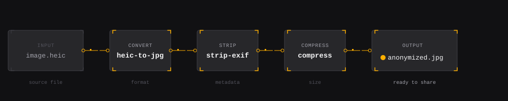
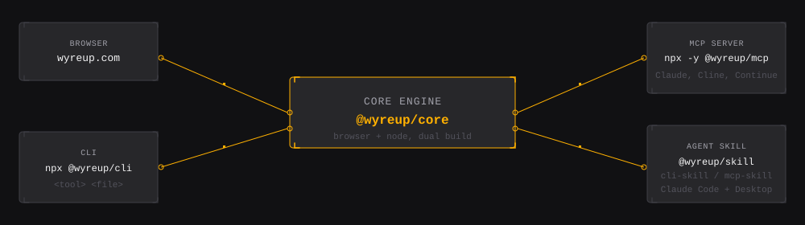

# Wyreup

**Wyreup your capabilities. Nothing uploads.**

[wyreup.com](https://wyreup.com) · MIT License


---

Wyreup is an open-source toolbelt for your files, your terminal, and your agent. Drop a file in the browser, run a command in your shell, or let your AI assistant invoke the same engine. Everything executes on your device — no server, no upload, no tracking.

The same tool engine ships across five surfaces. Whether you reach it from a browser, a CLI, or an MCP-compatible agent, the privacy guarantee is identical: nothing touches a server.

---

## What's possible

### Share a photo safely

Drop a HEIC or JPEG. Strip GPS coordinates and camera metadata, then compress it down to a size worth sending.

```
strip-exif → compress
```

Run it now: [wyreup.com/chain/run?steps=strip-exif|compress](https://wyreup.com/chain/run?steps=strip-exif%7Ccompress)

---

### Merge receipts into one searchable PDF

Drop receipt images. Convert each to a PDF page in one shot.

CLI:

```bash
wyreup image-to-pdf receipt1.jpg receipt2.jpg -o receipts.pdf
```

Or chain with PDF compression afterward:

```bash
wyreup chain receipt1.jpg receipt2.jpg --steps "image-to-pdf|pdf-compress" -o receipts.pdf
```

Run it now: [wyreup.com/chain/run?steps=image-to-pdf|pdf-compress](https://wyreup.com/chain/run?steps=image-to-pdf%7Cpdf-compress)

---

### Add visual covers and password-protect a PDF

Drop a PDF whose underlying content is safe for recipients to access. Add visual cover rectangles, a password and page numbers. The covers and password do not remove the underlying content.

```
pdf-redact → pdf-encrypt → page-numbers-pdf
```

Run it now: [wyreup.com/chain/run?steps=pdf-redact|pdf-encrypt|page-numbers-pdf](https://wyreup.com/chain/run?steps=pdf-redact%7Cpdf-encrypt%7Cpage-numbers-pdf)

---

### Enhance a low-quality voice memo

Drop an audio file. Wyreup upscales it to 48 kHz via a local ONNX model.

```
audio-enhance
```

CLI:

```bash
wyreup audio-enhance voicememo.m4a -o clean.wav
```

Run it now: [wyreup.com/tools/audio-enhance](https://wyreup.com/tools/audio-enhance)

---

## Chain anything

Every Wyreup tool takes a file and produces a file. Chain them to solve real problems in one pipeline.



Build a chain at [wyreup.com/chain/build](https://wyreup.com/chain/build). Save it to your Kit. Share the URL with anyone — they drop a file, it runs the exact pipeline on their device. No accounts required, no data leaves. (PRO is an optional credit-based tier for hosted-model tools — see below.)

---

## The catalog

- **Images** — compress, convert, resize, crop, rotate, flip, watermark, face blur, strip EXIF, image diff, OCR, SVG rendering, favicon generation, color palette and harmony, color-blind simulation, background removal, 2× upscale, image captioning
- **PDFs** — merge, split, compress, crop, rotate, reorder, extract and delete pages, extract images, page numbers, encrypt and decrypt, redact, extract tables and text, convert to and from images, watermark, metadata, prompt-injection scan
- **Audio + video** — trim, convert, compress, extract audio, transcribe (Whisper), burn or convert subtitles, video concat / crossfade / overlay / colour, video to GIF, enhance low-quality voice memos
- **Text** — diff, redact, suspicious-scan, confusable detection, template (mustache), word count, summarisation, translation, sentiment, NER, stats, readability, sentences, keywords, dates, unicode info, Markdown ↔ HTML
- **Dev** — JSON (format / diff / merge / flatten / path / schema infer + validate), YAML, XML ↔ JSON, SQL / HTML / CSS formatting and minify, regex, JWT decode, OpenAPI and `package.json` validation
- **Security & auth** — hash, HMAC, base32/58/64, TOTP / HOTP, JWT sign, signed URLs, signed cookies, backup codes, API and license keys, OTP-auth URIs, webhook verify and replay, file fingerprint
- **Privacy** — strip EXIF, face blur, PGP encrypt / decrypt / sign / verify / armor
- **Data** — CSV (info, dedupe, merge, diff, schema, mail-merge template), Excel ↔ CSV / JSON
- **Geo** — GeoJSON, KML, GPX, shapefile conversion
- **Create** — QR codes and barcodes, UUIDs, secure passwords, lorem ipsum, slugs
- **Finance** — compound interest, dollar-cost averaging, percentages, dates
- **Docs** — DOCX → text, article-text extraction (Reader-view), PDF form-field inspection and flattening
- **Archives** — ZIP create, extract, info, remove-by-glob, flatten

Full catalog: [wyreup.com/tools](https://wyreup.com/tools)

---

## Wyreup PRO

Everything above is free, forever. **PRO** is an optional credit-based tier for hosted-AI tools that need real servers — transcription (Whisper large-v3 turbo, with SRT/WebVTT subtitles), OCR, translation (100+ languages plus a dedicated Indic model), text-to-speech, image generation, long-context PDF Q&A (256k tokens), structured-JSON extraction, content safety classification, grammar fixing, tone rewriting, deep reasoning analysis, plus image background removal and upscaling. 30 tools today and growing.

- Pay-as-you-go packs contain **220 credits for $5**, **480 for $10**, or **1,000 for $20**. Pack credits never expire. The monthly plan grants **440 credits per paid $8 cycle**.
- New payments use Paddle when billing is configured. Open checkout from your signed-in account or a Pro tool, and use **Manage Paddle billing** in your account to manage purchases and subscriptions. Existing Lemon Squeezy subscriptions and refunds continue through the original receipt. See the [billing deployment guide](./DEPLOYMENT.md#paddle-billing) for sandbox setup and the live cutover.
- Failed runs auto-refund. The credit ledger is append-only — every spend / purchase / refund is auditable. Orphan spends from mid-handler crashes are auto-refunded on the next request.
- Same API key works across **browser**, **CLI** (`wyreup login` once, then any Pro tool runs from the shell), and **MCP** (set `WYREUP_API_KEY` in your MCP server config to expose Pro tools to your agent). Buying credits in one surface funds usage on every surface.
- Free tools and the anonymous experience are unchanged.

### PRO input and account migration

- Text-to-speech supports English and Spanish, with a 500-byte limit. Grammar accepts valid UTF-8 files up to 4,000 bytes and applies validated local grammar, spelling, and punctuation edits to the original text. Untouched text keeps its original spacing, line endings, and Unicode representation, including a leading byte-order mark. Invalid model edits fail and refund the run. Analysis accepts a 34,000-byte document and a 1,500-byte question. Each limit applies to both the original text and its NFKC-normalized UTF-8 form.
- Signup and account recovery deliver API keys only by email; the browser does not receive the key. The email-bound key rollout disables existing keys and their sessions while retaining account data and credits. Existing CLI and MCP users must request a new emailed key and update their local credentials or `WYREUP_API_KEY` configuration.
- Before deployment, complete authorized real-provider qualification and rehearse real inbox delivery plus recovered-admin access. See the [PRO model migration decisions](./docs/PRO-MODEL-MIGRATION-DECISIONS.md) and [email-bound auth migration release guide](./docs/auth-migration-release.md) for required checks. These notes do not indicate that the rollout is live or release-ready.
- Grammar qualification remains on hold after the near-cap case lost sentences with both earlier prompts. The local-edit candidate has no real-provider qualification; no further Gemma calls are authorized.
- All 12 original English/Spanish Aura REST fixtures passed response, MP3 decoding and deadline checks. Human audio acceptance, Workers AI binding behavior, actual billing and the recovery rehearsal remain unverified. These compatibility checks do not establish release readiness.

See [wyreup.com/pro](https://wyreup.com/pro) for what's hosted, [wyreup.com/legal/pricing](https://wyreup.com/legal/pricing) for prices, and [`docs/pro-auth-spec.md`](./docs/pro-auth-spec.md) for the full spec (D1 schema, atomic credit reservation, webhook idempotency, sanitization, CSP).

---

## Everywhere your files are

Wyreup ships as four packages built on one engine, with the agent skill
installed in-place by the CLI.



| Surface | How |
|---|---|
| Browser | [wyreup.com/tools](https://wyreup.com/tools) — no install |
| PWA | Install from browser for offline access and native file sharing |
| CLI | `npx @wyreup/cli <tool> <file>` |
| MCP server | `npx -y @wyreup/mcp` — connects Claude Code, Cline, Continue, and any MCP-compatible agent |
| Agent skill | `wyreup install-skill` — installs a skill.md into your agent's skills directory |

---

## Install as an app


Open [wyreup.com](https://wyreup.com) and install as a PWA. On mobile, share any file from any app straight to Wyreup and see which tools can handle it. Configure which tools cache offline at [wyreup.com/settings](https://wyreup.com/settings).

---

## Architecture

| Package | Description |
|---|---|
| `packages/core` | Tool library (`@wyreup/core`) — framework-free, dual browser/Node build |
| `packages/web` | Astro 7 + Svelte 5 static site — wyreup.com, fully static, PWA |
| `packages/cli` | `wyreup` CLI (`@wyreup/cli`) |
| `packages/mcp` | MCP server (`@wyreup/mcp`) |
| `functions/` | Cloudflare Pages Functions for the PRO tier — auth, credits, admin, hosted-model dispatch. Only loaded for `/api/*` routes; doesn't ship to npm. |
| `migrations/` | D1 schema migrations applied via `pnpm db:apply:remote` / `db:apply:local`. |

Agent skills are installed via `wyreup install-skill [cli|mcp|combined]` —
the CLI fetches the current `skill.md` from GitHub and writes it into the
agent's skills directory. This replaces three deprecated npm packages
(`@wyreup/skill`, `@wyreup/cli-skill`, `@wyreup/mcp-skill`).

See [docs/ARCHITECTURE.md](./docs/ARCHITECTURE.md) for the full design.

---

## Development

Use Node 24 and pnpm 10.34.5 for full-workspace development, as in web CI.
The private web toolchain requires Node 22.23.4 or newer.
The published core, MCP, and CLI packages support Node 22.13.0 and later.
The package-consumer check assumes a caller-owned checkout, temporary directory, and trusted local package-manager executables.

```bash
pnpm install
pnpm build       # builds all packages in dependency order
pnpm test        # runs all test suites
```

Run the web app locally:

```bash
pnpm --filter @wyreup/web dev
```

Run the full stack with Pages Functions + local D1 (for PRO development):

```bash
pnpm dev:pages          # builds the static site and serves it under wrangler
pnpm db:apply:local     # applies pending migrations to the local D1 instance
```

Run just the core library tests:

```bash
pnpm --filter @wyreup/core test
```

Run the package-consumer evidence identity regression tests, including their real-filesystem check:

```bash
pnpm exec vitest run tools/test/consumer-evidence-identity.test.mjs
```

Scaffold a new tool:

```bash
wyreup init-tool
```

---

## Self-hosting

The site is a fully static Astro build that deploys to any static host. See [DEPLOYMENT.md](./DEPLOYMENT.md) for Cloudflare Pages setup, CI/CD workflow details, GitHub secrets, and npm publishing instructions.

---

## Contributing

See [CONTRIBUTING.md](./CONTRIBUTING.md). To scaffold a new tool module with the correct folder structure, types, defaults, test file, and registry entry, run `wyreup init-tool`.

---

## Contact · Security · License

General inquiries: hello@wyreup.com

Security issues: security@wyreup.com — please do not open a public issue for vulnerabilities.

MIT — see [LICENSE](./LICENSE).
