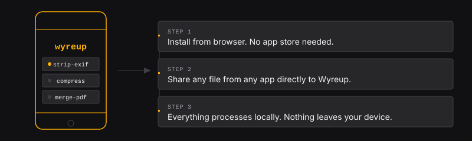

# Wyreup

**Wyreup your capabilities. Nothing uploads.**

[wyreup.com](https://wyreup.com) · MIT License


---

Wyreup is an open-source toolbelt for your files, your terminal, and your agent. Drop a file in the browser, run a command in your shell, or let your AI assistant invoke the same engine. Everything executes on your device — no server, no upload, no tracking.

The same tool engine ships across five surfaces. Whether you reach it from a browser, a CLI, or an MCP-compatible agent, the privacy guarantee is identical: nothing touches a server.

---

## What's possible

### Share a photo safely

Drop a HEIC or JPEG. Strip GPS coordinates and camera metadata, then compress it down to a size worth sending.

```
strip-exif → compress
```

Run it now: [wyreup.com/chain/run?steps=strip-exif|compress](https://wyreup.com/chain/run?steps=strip-exif%7Ccompress)

---

### Merge receipts into one searchable PDF

Drop receipt images. Convert each to a PDF page in one shot.

CLI:

```bash
wyreup image-to-pdf receipt1.jpg receipt2.jpg -o receipts.pdf
```

Or chain with PDF compression afterward:

```bash
wyreup chain receipt1.jpg receipt2.jpg --steps "image-to-pdf|pdf-compress" -o receipts.pdf
```

Run it now: [wyreup.com/chain/run?steps=image-to-pdf|pdf-compress](https://wyreup.com/chain/run?steps=image-to-pdf%7Cpdf-compress)

---

### Redact and password-protect a PDF

Drop a PDF, select areas to remove, then add a password and page numbers. Redact PDF rebuilds every page at 144 DPI, overwrites covered image pixels, and preserves extractable text outside the boxes. Glyphs touching a box are removed in full. Source metadata, annotations, forms, attachments and original PDF objects are discarded. Pages become images with a new invisible text layer, so vector quality and document interactivity are lost and files may grow. Everything runs locally; review the exported copy before sharing. Compress PDF is optional and is not needed to make redaction permanent.

```
pdf-redact → pdf-encrypt → page-numbers-pdf
```

Run it now: [wyreup.com/chain/run?steps=pdf-redact|pdf-encrypt|page-numbers-pdf](https://wyreup.com/chain/run?steps=pdf-redact%7Cpdf-encrypt%7Cpage-numbers-pdf)

---

### Enhance a low-quality voice memo

Drop an audio file. Wyreup upscales it to 48 kHz via a local ONNX model.

```
audio-enhance
```

CLI:

```bash
wyreup audio-enhance voicememo.m4a -o clean.wav
```

Run it now: [wyreup.com/tools/audio-enhance](https://wyreup.com/tools/audio-enhance)

---

## Chain anything

Every Wyreup tool takes a file and produces a file. Chain them to solve real problems in one pipeline.


Build a chain at [wyreup.com/chain/build](https://wyreup.com/chain/build). Save it to your Kit. Share the URL with anyone — they drop a file and run the pipeline on their device. No account is required. Public network lookups disclose their requests separately; local AI tools may download model files before processing on your device.

---

## The catalog

- **Images** — compress, convert, resize, crop, rotate, flip, watermark, face blur, strip EXIF, image diff, OCR, SVG rendering, favicon generation, color palette and harmony, color-blind simulation, background removal, 2× upscale, image captioning
- **PDFs** — merge, split, compress, crop, rotate, reorder, extract and delete pages, extract images, page numbers, encrypt and decrypt, redact, extract tables and text, convert to and from images, watermark, metadata, prompt-injection scan
- **Audio + video** — trim, convert, compress, extract audio, transcribe (Whisper), burn or convert subtitles, video concat / crossfade / overlay / colour, video to GIF, enhance low-quality voice memos
- **Text** — diff, redact, suspicious-scan, confusable detection, template (mustache), word count, summarisation, translation, sentiment, NER, stats, readability, sentences, keywords, dates, unicode info, Markdown ↔ HTML
- **Dev** — JSON (format / diff / merge / flatten / path / schema infer + validate), YAML, XML ↔ JSON, SQL / HTML / CSS formatting and minify, regex, JWT decode, OpenAPI and `package.json` validation
- **Security & auth** — hash, HMAC, base32/58/64, TOTP / HOTP, JWT sign, signed URLs, signed cookies, backup codes, API and license keys, OTP-auth URIs, webhook verify and replay, file fingerprint
- **Privacy** — strip EXIF, face blur, PGP encrypt / decrypt / sign / verify / armor
- **Data** — CSV (info, dedupe, merge, diff, schema, mail-merge template), Excel ↔ CSV / JSON
- **Geo** — GeoJSON, KML, GPX, shapefile conversion
- **Create** — QR codes and barcodes, UUIDs, secure passwords, lorem ipsum, slugs
- **Finance** — compound interest, dollar-cost averaging, percentages, dates
- **Docs** — DOCX → text, article-text extraction (Reader-view), PDF form-field inspection and flattening
- **Archives** — ZIP create, extract, info, remove-by-glob, flatten

Full catalog: [wyreup.com/tools](https://wyreup.com/tools)

---

## Free-only service

Wyreup offers free browser and local tools. Hosted inference, account signup and payments are retired. The website excludes hosted tools from its catalog, search, task pages and chains. Old account, billing and hosted-tool API requests return HTTP 410 before authentication, database access, email or model execution. Existing CLI/MCP installations may still list legacy hosted definitions; those requests are rejected by the service. Local tools remain available without an account or API key.

Browser model downloads from `models.wyreup.com` support inference on your device. The domain-registration lookup remains a disclosed public network request. Neither performs hosted AI inference. The site has no email signup or cross-product promotion.

The matching CLI patch updates the installer's integrity pins for the current skill documents. Upgrade the CLI before installing that guidance; older clients reject changed documents rather than install unverified instructions. Existing local tool commands remain available.

Existing database records and historical migration files are preserved. A new migration sets the old service switch to disabled as defense in depth; database state cannot re-enable retired routes. The release procedure and relevant checks are documented in [free-only service retirement](./docs/free-only-service.md).

The current Pages source removes the private billing, account, email and hosted model helpers. Requests for retired hosted tool pages redirect to `/tools/` before static assets can serve old HTML. Release verification must also cover older immutable Pages deployment URLs and their aliases. Roll back only to a free-only deployment that has passed the compiled retirement probes.

The obsolete bulk production secret-push script is removed. Use the current [deployment guide](./DEPLOYMENT.md) for the retained public service and its required configuration.

---

## Everywhere your files are

Wyreup ships as four packages built on one engine, with the agent skill
installed in-place by the CLI.


| Surface | How |
|---|---|
| Browser | [wyreup.com/tools](https://wyreup.com/tools) — no install |
| PWA | Install from browser for offline access and native file sharing |
| CLI | `npx @wyreup/cli <tool> <file>` |
| MCP server | `npx -y @wyreup/mcp` — connects Claude Code, Cline, Continue, and any MCP-compatible agent |
| Agent skill | `wyreup install-skill` — installs a skill.md into your agent's skills directory |

---

## Install as an app



Open [wyreup.com](https://wyreup.com) and install as a PWA. On mobile, share any file from any app straight to Wyreup and see which tools can handle it. Configure which tools cache offline at [wyreup.com/settings](https://wyreup.com/settings).

---

## Architecture

| Package | Description |
|---|---|
| `packages/core` | Tool library (`@wyreup/core`) — framework-free, dual browser/Node build |
| `packages/web` | Astro 7 + Svelte 5 static site — wyreup.com, fully static, PWA |
| `packages/cli` | `wyreup` CLI (`@wyreup/cli`) |
| `packages/mcp` | MCP server (`@wyreup/mcp`) |
| `functions/` | Cloudflare Pages Functions for public domain lookups and fail-closed retirement of other API routes. Doesn't ship to npm. |
| `migrations/` | D1 schema migrations applied via `pnpm db:apply:remote` / `db:apply:local`. |

Agent skills are installed via `wyreup install-skill [cli|mcp|combined]` —
the CLI fetches the current `skill.md` from GitHub and writes it into the
agent's skills directory. This replaces three deprecated npm packages
(`@wyreup/skill`, `@wyreup/cli-skill`, `@wyreup/mcp-skill`).

See [docs/ARCHITECTURE.md](./docs/ARCHITECTURE.md) for the full design.

---

## Development

Use Node 24 and pnpm 10.34.5 for full-workspace development, as in web CI.
The private web toolchain requires Node 22.23.4 or newer.
The published core, MCP, and CLI packages support Node 22.13.0 and later.
The package-consumer check assumes a caller-owned checkout, temporary directory, and trusted local package-manager executables.

```bash
pnpm install
pnpm build       # builds all packages in dependency order
pnpm test        # runs all test suites
```

Run the web app locally:

```bash
pnpm --filter @wyreup/web dev
```

Run the public network lookup with Pages Functions and local D1:

```bash
pnpm dev:pages          # builds the static site and serves it under wrangler
pnpm db:apply:local     # applies pending migrations to the local D1 instance
```

Run just the core library tests:

```bash
pnpm --filter @wyreup/core test
```

After building core, run the emitted ESM/CommonJS redaction smoke test with `pnpm exec vitest run tools/test/pdf-redact-packaged.test.mjs`. Redaction regression tests generate synthetic PDFs and use PDF.js extraction and image samples; they also run `pdftotext` when Poppler is installed.

Maintain corrected tool copy in `packages/web/src/lib/search-guides.ts`. To refresh one generated SEO entry without the original backfill batches, run `node scripts/seo-assemble.mjs --refresh-tool pdf-redact`, then format `packages/web/src/lib/seo-content.ts` with Prettier.

Run the package-consumer evidence identity regression tests, including their real-filesystem check:

```bash
pnpm exec vitest run tools/test/consumer-evidence-identity.test.mjs
```

Scaffold a new tool:

```bash
wyreup init-tool
```

---

## Self-hosting

The site is a fully static Astro build that deploys to any static host. See [DEPLOYMENT.md](./DEPLOYMENT.md) for Cloudflare Pages setup, CI/CD workflow details, GitHub secrets, and npm publishing instructions.

---

## Contributing

See [CONTRIBUTING.md](./CONTRIBUTING.md). To scaffold a new tool module with the correct folder structure, types, defaults, test file, and registry entry, run `wyreup init-tool`.

---

## Contact · Security · License

General inquiries: hello@wyreup.com

Security issues: security@wyreup.com — please do not open a public issue for vulnerabilities.

MIT — see [LICENSE](./LICENSE).
